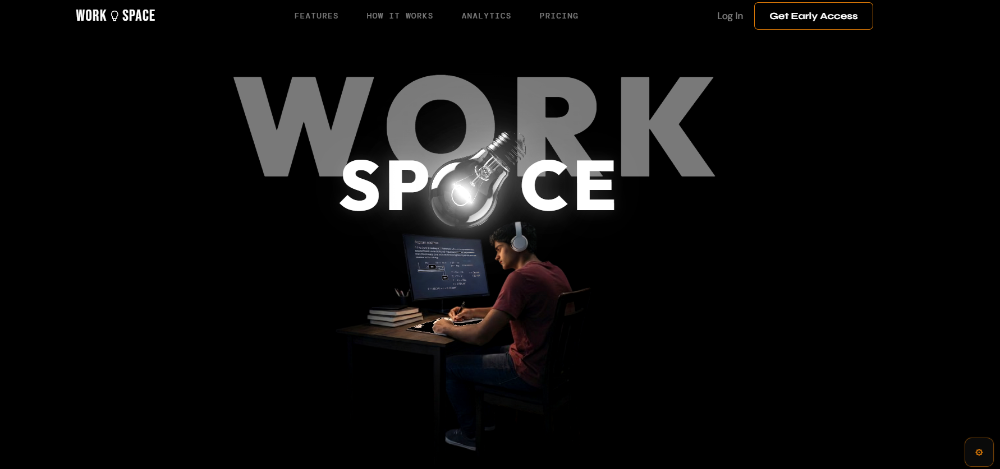
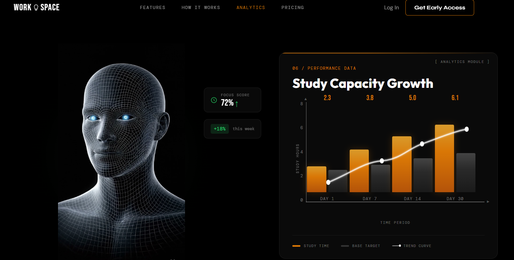
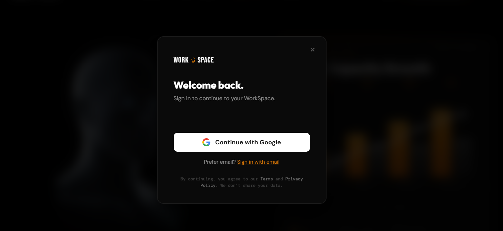
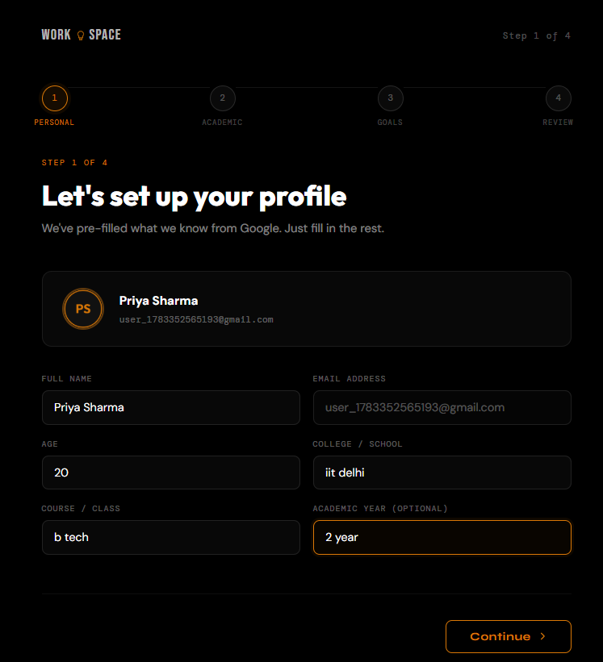
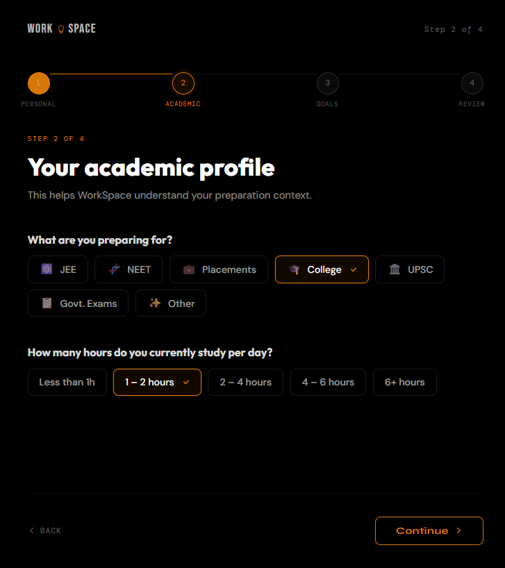
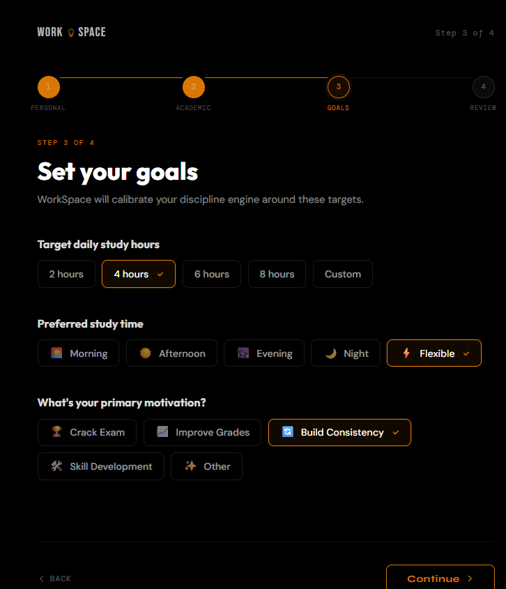
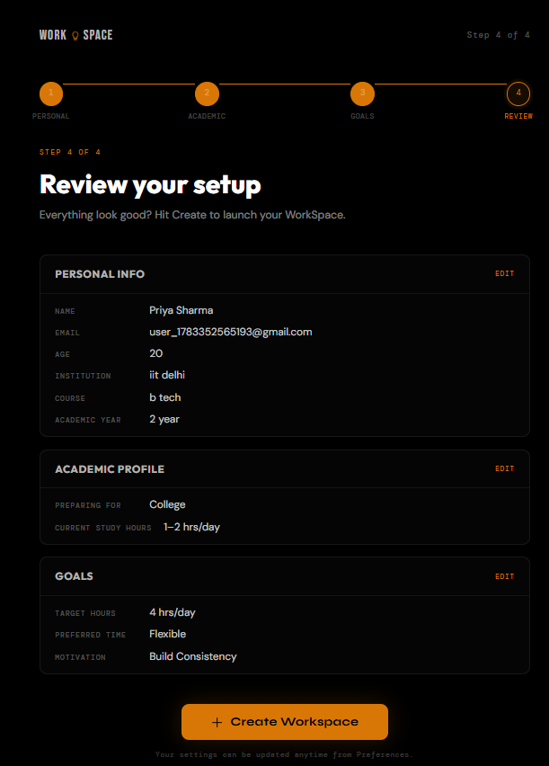
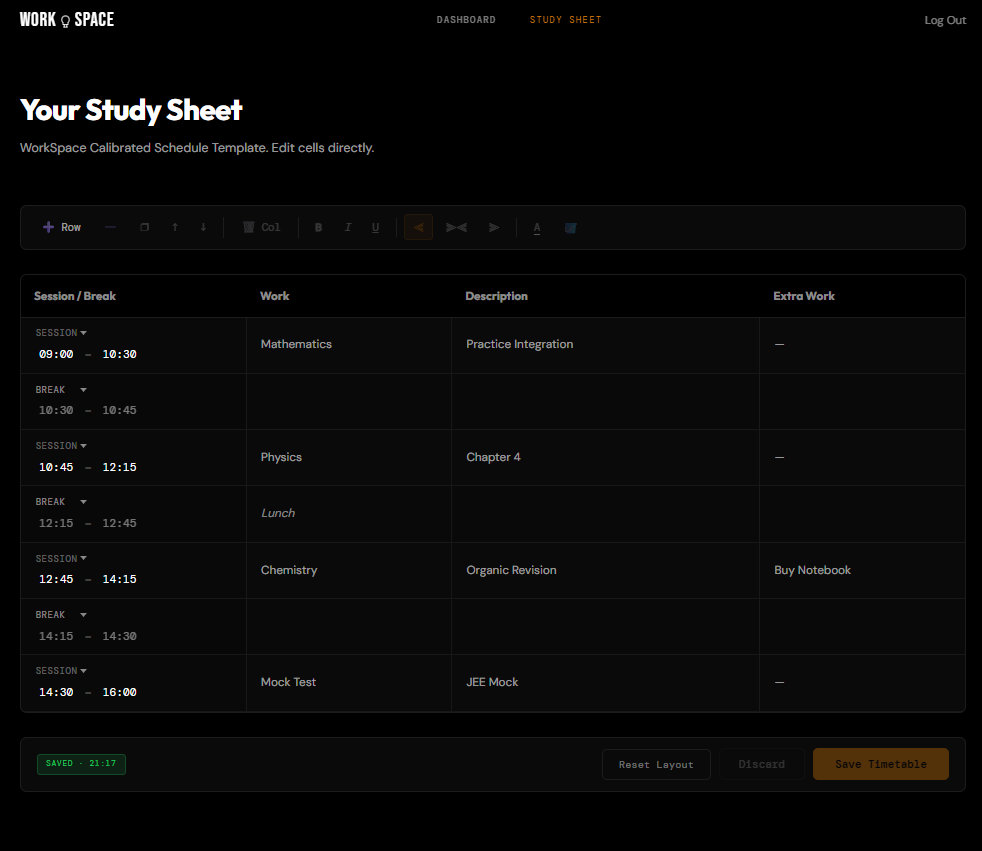
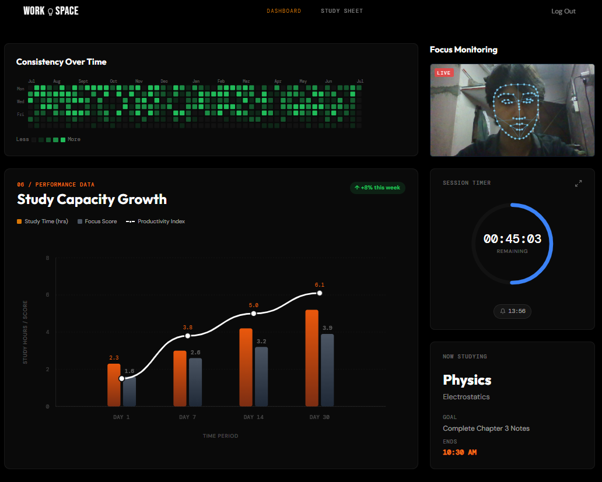

# WorkSpace — Cognitive Discipline & Performance System

<div align="center">

> *"Discipline is a skill that can be trained. WorkSpace is the training ground."*

[](https://chromewebstore.google.com/detail/workspace-ai-tab-monitor/gkpkmkfcneilbmkekpgnifklkfchbaib)
[](https://python.org)
[](https://fastapi.tiangolo.com)
[](docs/architecture/Overview.md)
[](LICENSE)

**A desktop cognitive training cockpit for serious students preparing for high-stakes exams (JEE, NEET, UPSC, GATE, Software Placements).**

[Install Chrome Extension](https://chromewebstore.google.com/detail/workspace-ai-tab-monitor/gkpkmkfcneilbmkekpgnifklkfchbaib) • [Architecture Docs](docs/architecture/Overview.md) • [Design System](docs/architecture/DesignSystem.md) • [Product PRD](docs/product/PRD.md)

</div>

---

## 📸 Interface Preview

### 1. Hero & Cognitive Immersion
A distraction-free, desaturated aesthetic designed to keep cognitive load low and intent high.



---

### 2. Cognitive Analytics & 3D Attention Modeling
Visual feedback maps gaze, deflection, and cognitive stamina over long study sessions.



---

### 3. Distraction-Free Authentication
Minimalist entry modal with Google OAuth and direct email access.



---

### 4. 4-Step Baseline Calibration Flow
Before stepping into the workspace, students complete an honest calibration of their targets, baseline stamina, and primary distractions.

| Step 1: Target & Exam | Step 2: Baseline Hours |
|:---:|:---:|
|  |  |
| **Step 3: Distraction Profile** | **Step 4: Calibration Confirmation** |
|  |  |

---

### 5. Adaptive Timetable & Study Sheet
Structured scheduling with real-time slot verification and subject breakdown.



---

### 6. Study Cockpit & Live Dashboard
The main command center: combines the consistency heatmap, real-time focus monitoring via webcam, session countdowns, and progressive overload metrics.



---

## 💡 Why WorkSpace Exists

Most productivity apps fail serious students because they focus on **motivation** rather than **discipline**. Dopamine-driven streak counters, colorful gamified widgets, and passive timers create an illusion of productivity while leaving students distracted, anxious, and inconsistent.

WorkSpace closes the entire cognitive loop:

```
Goal → Plan → Study → Monitor → Correct → Break → Analyze → Progressive Overload
```

1. **Discipline Over Motivation**: Treats study sessions as deliberate training blocks to expand cognitive capacity.
2. **Deterministic Feedback**: Real-time camera & tab telemetry detecting deflections and idle periods.
3. **Friction-Based Interventions**: Emergency overrides require reflection buffers to stop impulsive exits.
4. **Progressive Overload**: Just like gym training, target hours escalate systematically as consistency improves.

---

## 🧩 Official Chrome Extension

WorkSpace pairs directly with our companion Chrome Extension for seamless tab classification and distraction defense:

👉 **[Download on Chrome Web Store](https://chromewebstore.google.com/detail/workspace-ai-tab-monitor/gkpkmkfcneilbmkekpgnifklkfchbaib)**

- **Real-Time Tab Classification**: Categorizes active tabs into academic resources vs. distraction traps.
- **Friction Blocker**: Injects immediate intervention overlays when visiting blacklisted sites during an active focus block.
- **Background Sync**: Communicates directly with the local AI backend and web dashboard.

---

## 🏛 System Architecture

The project is structured as a decoupled multi-service system:

```
workspace/
├── frontend/             # Modular Vanilla ES Modules cockpit (HTML/CSS/JS)
├── ai-backend/           # FastAPI Python brain (Screen & Face Landmarker analysis)
├── backend/              # Node.js/Express service (Voice assistance & persistence)
├── browser-extension/    # Manifest V3 Chrome Extension source code
├── workspace-react/      # Companion React/Vite frontend implementation
├── docs/                 # Architecture decisions, PRDs, and Design System specs
└── screenshots/          # High-resolution UI captures
```

| Service | Technology | Port | Responsibility |
|---|---|---|---|
| **Frontend** | Vanilla ES Modules, CSS Tokens | `3000` | Landing, Onboarding, Timetable, Study Cockpit |
| **AI Backend** | Python 3.11+, FastAPI, MediaPipe | `8000` | Real-time face mesh, posture, and tab classification |
| **Node Backend** | Node.js, Express | `4001` | Session routing, voice assistance |
| **Browser Extension** | Manifest V3, WebExtensions API | — | Active tab surveillance & distraction blocking |

---

## 🚀 Quick Start Guide

You can run individual services or the entire system locally:

### 1. Run the Frontend (Client Cockpit)

```bash
cd frontend
python3 -m http.server 3000
# or: python3 local_server.py
```
Open **`http://localhost:3000`** in your browser.

> *Note: In development mode, the **Developer Panel** (⚙ icon at the bottom-right) enables instant auth state toggling, onboarding bypass, and backend latency simulation.*

---

### 2. Run the AI Backend (Python & FastAPI)

The AI backend handles real-time focus detection and tab analysis:

```bash
cd ai-backend

# Setup virtual environment
python3 -m venv venv
source venv/bin/activate  # On Windows: venv\Scripts\activate

# Install dependencies
pip install -r requirements.txt

# Run FastAPI server
cd app
python3 main.py
```
The AI API runs on **`http://localhost:8000`** (Swagger docs at `/docs`).

---

### 3. Run the Node Backend (Optional)

```bash
cd backend
npm install
npm run dev
```
The Node API runs on **`http://localhost:4001`**.

---

### 4. Install the Chrome Extension

- **Option A (Chrome Web Store)**: Install with 1 click from the [Chrome Web Store](https://chromewebstore.google.com/detail/workspace-ai-tab-monitor/gkpkmkfcneilbmkekpgnifklkfchbaib).
- **Option B (Local Unpacked)**:
  1. Go to `chrome://extensions/` in Chrome.
  2. Toggle **Developer mode** (top-right).
  3. Click **Load unpacked** and select the [`browser-extension/`](browser-extension/) directory.

---

## 📚 Technical Documentation

Deep dive into the architecture and specifications in [`docs/`](docs/):

- 📐 **[Technical Architecture](docs/architecture/TechnicalArchitecture.md)** — Detailed component diagrams and data flow.
- 🎨 **[Design System Guidelines](docs/architecture/DesignSystem.md)** — Tokens, typography, dark mode rules, and atomic UI constraints.
- 🔌 **[API Contracts](docs/architecture/ApiContracts.md)** — Request/response schemas for frontend-backend interaction.
- 📋 **[Product Requirements Document (PRD)](docs/product/PRD.md)** — User personas, functional requirements, and metrics.
- 🛣 **[Product Roadmap](docs/product/Roadmap.md)** — Milestone releases from v0.2.0 to v1.0.0.

---

## 📄 License

This project is licensed under the MIT License - see the [LICENSE](LICENSE) file for details.
